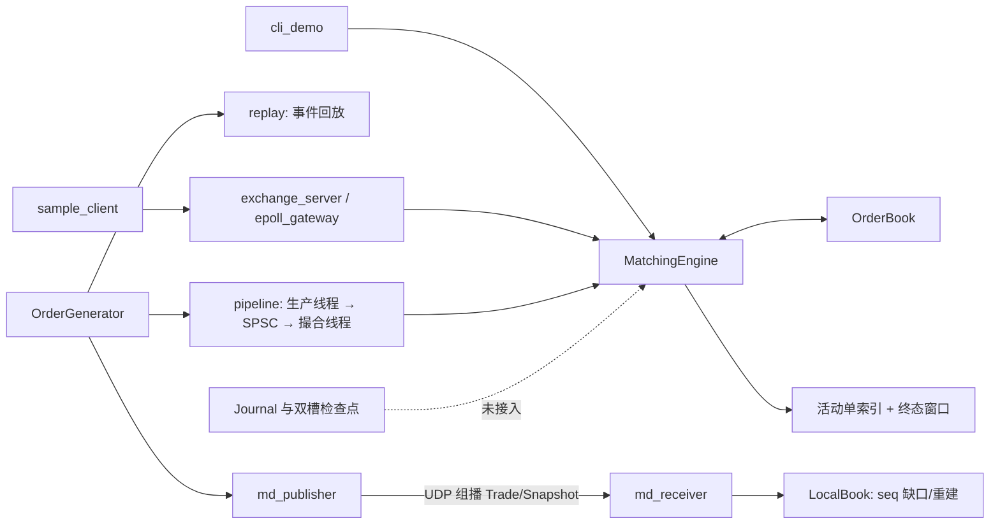

# MiniExchange：C++20 订单簿、撮合与交易基础设施

MiniExchange 是一个单节点的 C++20 交易系统项目，围绕订单簿与撮合核心，实现确定性事件回放、TCP 订单接入、UDP 行情通道、SPSC 无锁流水线、epoll 多连接网关和可复现的性能基准。

当前源码对应 **v1.2**。项目目标是工程可验证：撮合规则有测试、回放结果可逐字节复现、并发通路有 TSan 验证、性能数字附完整环境与测量方法。

> 项目定位为单节点交易基础设施的实现与验证：不连接真实交易所，不包含真实资金、生产级风控与高可用。

## 当前能力

| 模块 | 状态 |
| --- | --- |
| 订单簿与撮合引擎 | 整数 tick 价格、价格优先/时间优先、限价单、市价单（IOC）、撤单、部分成交、严格递增订单 ID、4096 终态窗口 |
| 自动化测试 | 8 个 CTest 目标；撮合规则 17 项用例，含对象池等价性 |
| 事件回放 | 固定种子订单流、事件文本序列化、确定性回放、两次输出逐字节一致 |
| TCP 订单接入 | 长度前缀分帧；单线程阻塞式服务器；epoll 多连接网关（LT/ET、部分读写、背压） |
| UDP 行情 | 组播/单播、成交/快照共用 seq、缺口检测、快照请求、本地最优一档重建 |
| 并发数据通路 | 单生产者单消费者无锁队列（release/acquire、缓存行隔离）、双线程撮合流水线、TSan |
| 日志与检查点 | 二进制 Journal（QJNL、FNV-1a、尾部修复）与双槽检查点 API |
| 性能测量 | 三负载引擎基准、SPSC vs mutex 对比、网关 QPS、流水线分位数、callgrind 热点与优化前后数据 |

明确未实现：

- 真实交易所/券商接入、真实行情协议（ITCH/FAST/SBE）、FIX；
- 完整深度订单簿重建（当前行情通道只维护最优一档）；
- 多合约路由、FOK/Stop 单、自成交防护；
- 分布式撮合/共识、TLS、心跳与断线重连；
- 撮合状态的 Journal 自动恢复（Journal 与检查点仍是独立基础设施）。

## 快速开始

环境要求：

- Linux 或 WSL2（推荐 Ubuntu 24.04）；
- GCC 13+ 或 Clang 17+，CMake 3.22+；
- POSIX 网络目标需要 pthread；Windows 构建会跳过网络相关目标。

```bash
cmake -S . -B build -DCMAKE_BUILD_TYPE=Release
cmake --build build -j
ctest --test-dir build --output-on-failure
```

命令行撮合演示：

```bash
./build/cli_demo < orders.txt
```

`orders.txt` 包含限价/市价/撤单/部分成交/非法参数等 26 条命令，输出成交序列、订单状态与盘口快照。

## 系统架构



核心原则：

- **撮合核心始终单线程**，并发输入通过队列串行化，保证确定性与低延迟；
- **价格用整数 tick**，时间优先用引擎分配的单调 `seq`，不依赖墙钟；
- **IO 与撮合解耦**：TCP/UDP/epoll 负责传输，撮合线程只消费事件；
- **协议编解码、缺口状态机、帧解析都是纯逻辑模块**，可以脱离 socket 单测。

## 主要模块与用法

### 1. 撮合引擎与 CLI

- `include/exchange/order_book.hpp`、`src/order_book.cpp`：双边价格档位、同价 FIFO、`locations_` 哈希索引实现 O(1) 撤单、档位总量 128 位累加与饱和。
- `include/exchange/matching_engine.hpp`、`src/matching_engine.cpp`：提交校验、撮合循环、订单生命周期、终态环形缓冲。
- `src/main.cpp`：`N/C/S/Q/X` 交互式 CLI。

```bash
./build/cli_demo < orders.txt
```

撮合规则：

- 限价买单只吃价格不高于买价的卖单，限价卖单只吃价格不低于卖价的买单；
- 成交价始终取簿内挂单价；一个吃单可以产生多笔不同价格的成交；
- 市价单跳过价格检查，未成交部分按 IOC 撤销；
- 客户端订单 ID 必须严格递增；终态订单不复用 ID，最近 4096 个终态可查询。

### 2. 事件回放

- `include/exchange/order_generator.hpp`、`src/order_generator.cpp`：固定种子生成可复现事件流。
- `include/exchange/replay.hpp`、`src/replay.cpp`：事件文本编解码、逐条回放、成交与最终快照输出。

```bash
./build/replay gen 42 1000000 events.log
./build/replay run events.log trades1.log
./build/replay run events.log trades2.log
cmp trades1.log trades2.log && echo identical
```

事件格式：

```
N <id> <B|S> <L|M> <price> <qty>
C <id>
```

输出格式：每笔成交 `T buy sell price qty seq`，末尾 `S best_bid bid_qty best_ask ask_qty next_seq`。同一输入两次回放逐字节一致。

### 3. TCP 订单接入与 epoll 网关

TCP 帧格式：4 字节小端长度 + payload。请求命令：

```
N <id> <B|S> <price> <qty>   # price=0 表示市价单
C <id>
S <id>
Q
```

响应（一帧可多行）：

```
R OK
R REJ <原因码>
T <buy> <sell> <price> <qty> <seq>
Q <bid> <bid_qty> <ask> <ask_qty> <seq>
S <Status> / S NONE
E BAD_CMD / E BAD_ARGS
```

单线程阻塞式服务器：

```bash
./build/exchange_server 9001
./build/sample_client 127.0.0.1 9001 1000 42
```

epoll 多连接网关：

```bash
# LT 模式
./build/epoll_gateway --port 9201

# ET 模式
./build/epoll_gateway --port 9202 --et

# 多客户端压测
./build/gateway_bench 4 5000 9201
```

网关结构：

```
[多个 TCP 客户端]
        │
        ▼
[epoll IO 线程] ──请求 SPSC──▶ [撮合线程: MatchingEngine]
        ▲                              │
        └──────响应 SPSC + eventfd ◀────┘
```

- IO 线程负责 accept/read/write/epoll，每连接维护输入 `FrameDecoder` 与输出缓冲；
- 撮合线程只消费请求、调用命令处理函数，把响应放回队列，并写 `eventfd` 唤醒 IO 线程；
- LT 模式依赖水平触发反复通知；ET 模式必须在一次事件里循环 `accept/recv/send` 到 `EAGAIN`；
- `send` 部分写时保留输出缓冲并注册 `EPOLLOUT`；
- 请求队列满时暂停该连接读取，把剩余帧放入 `pending`；响应队列满时撮合线程自旋形成背压；输出超过 1 MiB 的慢客户端会被断开；
- 连接 ID 与 fd 分离，避免 fd 复用把旧响应发给新连接。

### 4. UDP 行情与缺口恢复

消息协议（文本，便于调试）：

```
T <seq> <buy_id> <sell_id> <price> <qty>
S <seq> <best_bid> <bid_qty> <best_ask> <ask_qty>
REQ <expected_seq>    # 接收端 → 发布端，UDP 单播
```

- 成交和快照共用单调递增 `seq`，发布端从 `seq=1` 开始，初始先发一条快照；
- 接收端 `LocalBook` 状态机：

| 结果 | 条件 | 动作 |
| --- | --- | --- |
| `Rebuilt` | 收到 `seq >= expected` 的快照 | 覆盖本地簿，`expected = seq + 1`，解除失步 |
| `GapDetected` | 成交 `seq > expected` | 记录缺口，进入失步，立即请求快照 |
| `Applied` | 成交 `seq == expected` | 更新最新成交，`expected++` |
| `Duplicate` | 任意消息 `seq < expected` | 丢弃（重复/过期） |
| `Ignored` | 失步期间的成交 | 丢弃，等待快照 |

运行：

```bash
# 终端 1：先启动接收端
./build/md_receiver --duration-ms 3000

# 终端 2：发布 10 万事件，每 2000 条模拟丢 1 条，关闭周期快照
./build/md_publisher --events 100000 --seed 42 --drop-every 2000 --snapshot-every 0
```

- 缺口出现时接收端立即请求快照，失败则每 50 ms 重试；
- 快照 `seq` 对齐后继续消费增量；过期快照和重复消息直接丢弃；
- WSL 组播不通时，两端加 `--unicast` 走 127.0.0.1。

### 5. SPSC 双线程流水线与基准

```bash
./build/pipeline 1000000 42
./build/spsc_bench 1000000
```

- `pipeline`：订单生成线程 → `SpscQueue<Event, 16384>` → 单线程撮合；分别统计 queue wait、撮合 service 与端到端延迟；
- `spsc_bench`：同一负载下比较 SPSC 与 `std::queue + mutex + condition_variable`，容量 64 / 16384 两组；
- `pipeline_test` 断言流水线结果与单线程顺序处理完全一致。

SPSC 内存序：

- 生产者 `release` 写 tail，消费者 `acquire` 读 tail；
- 消费者 `release` 写 head，生产者 `acquire` 读 head；
- 读写游标各占 64 字节缓存行，消除伪共享；
- 队列满返回 false 并设置粘性 overflow 标志，背压策略由调用方决定。

### 6. 日志与检查点

- `include/exchange/journal.hpp`、`src/journal.cpp` 提供独立文件级 API；
- 记录格式：`QJNL` 魔数 + 版本 + 类型 + 载荷长度 + 载荷 + FNV-1a 32 位校验，整数显式小端；
- `scan()` 逐条回调，`read()` 收集完整记录；截断尾部可修复，完整记录校验错误会抛异常；
- 双槽检查点通过临时文件、刷盘和原子替换写入，读取时选择有效且较新的槽；
- 当前**未**与撮合状态自动恢复对接：缺少订单事件编码、引擎状态快照和重启对账。

### 7. 引擎三负载基准

```bash
./build/engine_bench 1000000 42
```

覆盖限价为主、撤单密集、成交密集三类负载，输出吞吐与 `submit/cancel` service P50/P95/P99；每 5 万事件重置引擎，避免订单簿无限膨胀导致漂移。包含 `baseline`、`pool`、`pool+reserve` 三组对比。

## 关键设计决策

### 整数 tick 价格

`Price = int64_t`，1 tick = 0.01。避免 IEEE 754 的精度、舍入与 NaN 问题；整数比较单指令且确定。`double` 只出现在展示层换算。

### 单调 seq 与确定性

订单到达时分配 `seq`，成交也分配 `seq`。撮合不读墙钟、不依赖哈希遍历顺序；同一事件流在任意机器上产生相同的成交序列。这是回放对拍与事故复盘的基础。

### 价格档位与撤单

买卖两侧使用同类型升序 `std::map<Price, PriceLevel>`：

- 买盘最优价取 `rbegin()`，卖盘取 `begin()`；
- `PriceLevel` 使用 `std::list` + `locations_` 哈希索引，撤单/完全成交按订单 ID 定位，平均 O(1)；
- 档位总量用高低两个 64 位字段累加，对外饱和为 `UINT64_MAX`。

### 终态窗口环形缓冲

最近 4096 个终态订单用固定数组环形缓冲保存：写入 O(1)、无哈希、无分配；`statusOf` 从最新项反向扫描，最坏 O(4096)。这是一次由 callgrind 驱动的优化，限价负载吞吐 +20.6%、P99 -30.2%（本机 3 轮中位数）。

### 对象池实验（负结果）

订单对象曾用 `std::pmr::unsynchronized_pool_resource` 做 A/B，实测比 `std::make_shared` 慢 7%–11.6%，因此默认关闭，仅保留可选开关与正确性测试。结论：malloc 的 tcache 已经很快，PMR 的每块元数据和分派开销反而更高；继续优化应转向自定义 slab/free-list 或侵入式容器。

## 测试

```bash
ctest --test-dir build --output-on-failure
```

| 测试 | 覆盖 |
| --- | --- |
| `matching_test` | 价格/时间优先、状态、ID 单调、IOC、档位数量饱和、终态窗口、整链路回归、对象池等价性 |
| `journal_test` | 二进制往返、截断尾部、中间损坏、双槽新旧选择与损坏回退 |
| `spsc_test` | FIFO、满队列告警、并发顺序 |
| `replay_test` | 同种子同事件流、序列化往返、回放确定性、非法事件 |
| `pipeline_test` | 流水线结果与单线程一致、0/1 事件边界 |
| `market_data_test` | 行情编解码、正常流、缺口重建、过期快照、重复消息 |
| `frame_decoder_test` | 半包、多帧、超长帧、零长度帧 |
| `framing_test` | TCP 半包、粘包、EOF、非法长度（仅 POSIX） |

共 8 个 CTest 目标。并发测试另建议用 ThreadSanitizer：

```bash
cmake -S . -B build-tsan -DCMAKE_BUILD_TYPE=RelWithDebInfo \
      -DCMAKE_CXX_FLAGS="-fsanitize=thread -g -O1"
cmake --build build-tsan -j
ctest --test-dir build-tsan -R "spsc_test|pipeline_test|framing_test" --output-on-failure
```

## 性能结果

环境：WSL2 Ubuntu，4 vCPU，Intel i5-12500H，GCC 15.2.0，CMake 4.2.3，Release（`-O3 -DNDEBUG`）；未绑核，存在 WSL 调度抖动。数字只对本环境、本负载有效。

### 三负载引擎基准（1,000,000 事件，3 轮中位数）

| 负载 | 吞吐 | service P50 | service P99 |
| --- | --- | --- | --- |
| 限价为主（95% 限价 / 5% 市价） | 4.01 M events/s | 138 ns | 519 ns |
| 撤单密集（45% 限价 / 5% 市价 / 50% 撤单） | 6.09 M events/s | 102 ns | 489 ns |
| 成交密集（35% 限价 / 60% 市价 / 5% 撤单） | 7.49 M events/s | 78 ns | 324 ns |

### SPSC vs mutex 队列（1,000,000 条，容量 64）

| 实现 | 吞吐 | P50 | P99 |
| --- | --- | --- | --- |
| SPSC | 18.50 M/s | 1.91 µs | 5.56 µs |
| mutex + condition_variable | 1.67 M/s | 15.07 µs | 134.13 µs |

### 双线程流水线（1,000,000 事件）

| 指标 | 结果 |
| --- | --- |
| 成交 | 676,768 |
| 总耗时 / 吞吐 | 460.7 ms / 2.17 M events/s |
| 撮合 service P50 / P99 | 236 ns / 1.76 µs |
| queue wait P50 / P99 | 6.54 ms / 39.21 ms |
| end-to-end P50 / P99 | 6.54 ms / 39.21 ms |

端到端时间由队列积压主导；报告 SLO 时必须区分“引擎处理延迟”和“排队延迟”。

### epoll 网关（4 客户端 × 5,000 请求）

| 模式 | QPS | P50 | P99 |
| --- | --- | --- | --- |
| LT | 60,937 | 57.6 µs | 192 µs |
| ET | 71,506 | 49.4 µs | 214 µs |

复跑范围约 60k–78k QPS，受 WSL 调度影响；正式结论应多轮取中位数。

## 目录结构

```
MiniExchange/
├── CMakeLists.txt
├── README.md
├── orders.txt                      # CLI 手动对拍输入
├── include/exchange/
│   ├── types.hpp                   # Order / Trade / Snapshot / 错误码
│   ├── order_book.hpp              # 价格档位、FIFO、O(1) 定位
│   ├── matching_engine.hpp         # 撮合、生命周期、终态窗口
│   ├── order_generator.hpp         # 可复现事件流
│   ├── replay.hpp                  # 事件序列化与回放
│   ├── spsc.hpp                    # SPSC 无锁队列
│   ├── pipeline.hpp                # 双线程流水线与延迟采集
│   ├── journal.hpp                 # 二进制日志与检查点
│   ├── net.hpp                     # TCP 分帧、UDP/组播
│   ├── frame_decoder.hpp           # 增量帧解析
│   ├── gateway.hpp                 # 文本协议命令处理
│   └── market_data.hpp             # 行情编解码、LocalBook 状态机
├── src/                            # 对应实现
├── apps/
│   ├── replay.cpp                  # replay gen/run
│   ├── pipeline.cpp                # 双线程流水线
│   ├── exchange_server.cpp         # 单线程 TCP 服务器
│   ├── epoll_gateway.cpp           # epoll 多连接网关
│   ├── sample_client.cpp           # 订单流客户端
│   ├── gateway_bench.cpp           # 网关 QPS/延迟压测
│   ├── spsc_bench.cpp              # SPSC vs mutex
│   ├── engine_bench.cpp            # 三负载引擎基准
│   ├── md_publisher.cpp            # UDP 行情发布
│   └── md_receiver.cpp             # UDP 行情接收/重建
└── tests/                          # 8 个 CTest 目标
```

## 已知限制

1. **单节点**：没有分布式撮合、复制或共识；撮合核心单线程是确定性设计，不是并发缺陷。
2. **行情只重建最优一档**：完整深度需要深度快照与档位增量消息，当前未实现。
3. **多客户端订单 ID**：撮合引擎要求订单 ID 全局严格递增；epoll 网关支持多连接并发 IO，但多客户端同时下单需要网关分配全局订单 ID/会话映射，当前未实现。网关压测使用 `Q` 命令规避该约束。
4. **Journal 未接入撮合恢复**：日志与检查点是独立 API，缺少订单事件编码、引擎状态快照与重启对账。
5. **真实历史数据**：`data/real/` 下的 LOBSTER 样例只保存在本地、不提交；历史 message 不能直接喂给主动撮合的 `submit()`，需要独立的历史订单簿回放器（未实现）。
6. **性能数字只对本环境有效**：WSL2 虚拟化、未绑核、存在后台负载；正式结论应多轮取中位数，并附完整环境与测量方法。
