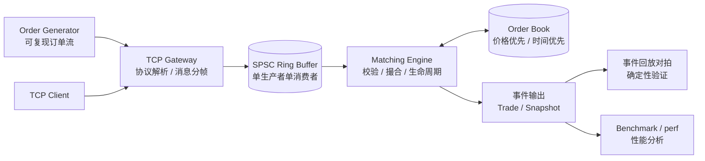

# MiniExchange — C++20 低延迟订单簿与行情处理系统

> 一个用于学习与求职展示的量化交易基础设施项目：从订单簿撮合引擎起步，逐步演进到 TCP 订单接入、无锁 SPSC 队列与系统化性能分析。
>
> 🟡 **项目进行中** —— 完整学习路线、分阶段教程与环境搭建指南见 [TUTORIAL.md](TUTORIAL.md)。下方路线图随开发进度勾选。

## 项目定位

- **目标岗位**：C++ Systems / Quant Developer / Trading Infrastructure
- **项目性质**：教学项目，模拟简化交易所的核心交易链路，**非生产系统**
- **核心价值**：正确性可测试、性能可测量、每个设计决策可解释

## 系统架构



订单流转：客户端/生成器 → TCP 长度前缀分帧 → SPSC 无锁队列解耦 → 单线程撮合引擎 → 成交与快照事件 → 回放对拍 + 性能测量。

## 目录结构

```
MiniExchange/
├── CMakeLists.txt            # 构建配置（核心库 / 演示 / 测试 / 基准）
├── include/exchange/         # 公共头文件（按命名空间分子目录）
│   ├── types.hpp             # Order / Trade / Snapshot / 错误码
│   ├── order_book.hpp        # 订单簿（价格优先、时间优先）
│   ├── matching_engine.hpp   # 撮合引擎（校验 / 撮合 / 生命周期）
│   ├── order_generator.hpp   # 可复现订单流生成器
│   └── spsc_queue.hpp        # 单生产者单消费者无锁队列
├── src/                      # 核心库实现
├── apps/                     # 可执行程序（演示 / 回放 / 服务端 / 客户端）
├── tests/                    # GoogleTest 单元测试
├── benchmark/                # Google Benchmark 性能基准
└── docs/
    ├── architecture.md       # 架构与设计决策
    └── benchmark.md          # 性能报告（环境 / 方法 / 数据）
```

## 技术栈

| 技术 | 用途 |
| --- | --- |
| C++20 | 语言标准（concepts 可选，jthread/span 等按需使用） |
| CMake 3.22+ | 构建系统（target 式写法、FetchContent 管理依赖） |
| GoogleTest | 撮合规则、边界条件、网络分帧的自动化测试 |
| Google Benchmark | 吞吐量与延迟基准 |
| Linux socket API | TCP 订单接入、长度前缀分帧 |
| std::atomic / 内存序 | SPSC 无锁队列（release/acquire、缓存行隔离） |
| ThreadSanitizer | 并发正确性验证 |
| perf / valgrind | CPU 热点分析与优化闭环 |

## 路线图

| 版本 | 内容 | 状态 |
| --- | --- | --- |
| v0.1 | 撮合引擎 MVP：限价/市价/撤单/部分成交/价格优先/时间优先/校验 | ⬜ |
| v0.2 | GoogleTest 全覆盖、CMake 工程化、README 与架构文档 | ⬜ |
| v0.3 | Order Generator、事件回放对拍、TCP Client/Server 与分帧 | ⬜ |
| v0.4 | SPSC 无锁队列、双线程流水线、TSan 验证 | ⬜ |
| v1.0 | Benchmark 吞吐/延迟分位数、perf 分析与优化闭环、性能报告 | ⬜ |
| 扩展 | UDP 组播行情、序号缺口检测、行情簿重建（见 TUTORIAL 第 7 章） | ⬜ |

## 构建与测试

```bash
# 构建（含测试）
cmake -S . -B build -DCMAKE_BUILD_TYPE=Release
cmake --build build -j

# 运行测试
ctest --test-dir build --output-on-failure

# 演示程序
./build/cli_demo

# 性能基准（完成阶段五后）
cmake -S . -B build -DMINIEX_BUILD_BENCH=ON -DCMAKE_BUILD_TYPE=Release
cmake --build build -j
./build/engine_bench

# ThreadSanitizer（并发验证用独立构建目录）
cmake -S . -B build-tsan -DCMAKE_BUILD_TYPE=RelWithDebInfo \
      -DCMAKE_CXX_FLAGS="-fsanitize=thread -g"
cmake --build build-tsan -j
```

## 关键设计决策

- **价格用 `int64_t` 整数 tick 表示**（1 tick = 0.01），杜绝浮点比较与舍入的不确定性；
- **时间优先用引擎分配的单调序号 seq**，不依赖系统时钟——撮合完全确定、可回放；
- **价格档位用 `std::map`**：有序结构使 best bid/ask 查询 O(1)，升级路径（数组索引/侵入式结构）由 OrderBook 接口隔离；
- **撮合核心永远单线程**：并发输入由 SPSC 队列串行化，换取确定性与低延迟；
- **市价单按 IOC 语义**：未成交部分撤销并报告，贴近真实交易所行为；
- **订单生命周期**：id 索引 + 订单簿双容器持有 `shared_ptr`，状态机 New → PartialFilled → Filled / Cancelled。

## 性能结果

见 [docs/benchmark.md](docs/benchmark.md)（完成阶段五后填写）。所有数字均来自本机实测，并完整记录测试环境与编译选项。

## 参考项目

- [cpp-matching-engine](https://github.com/ShaneWoloszyn/cpp-matching-engine) — 订单优先级、撤单、测试组织（对照设计，不照抄）
- [market-data-pipeline](https://github.com/ashutoshdayal13/market-data-pipeline) — C++20 SPSC Ring Buffer、生产者消费者线程与 TSan

## 声明

本项目为教学用途的简化实现，不连接真实交易所，不构成任何交易建议。
